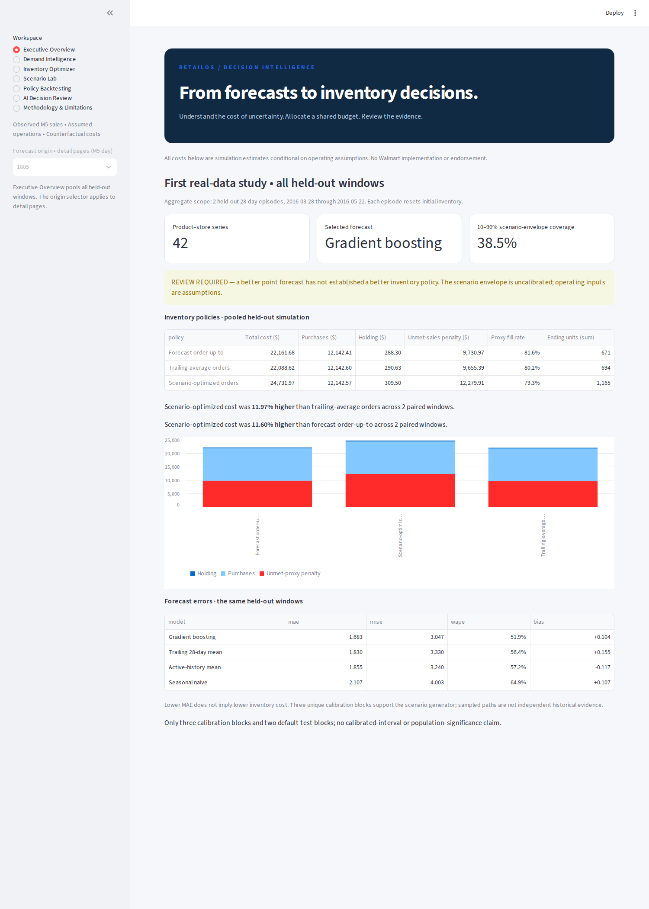
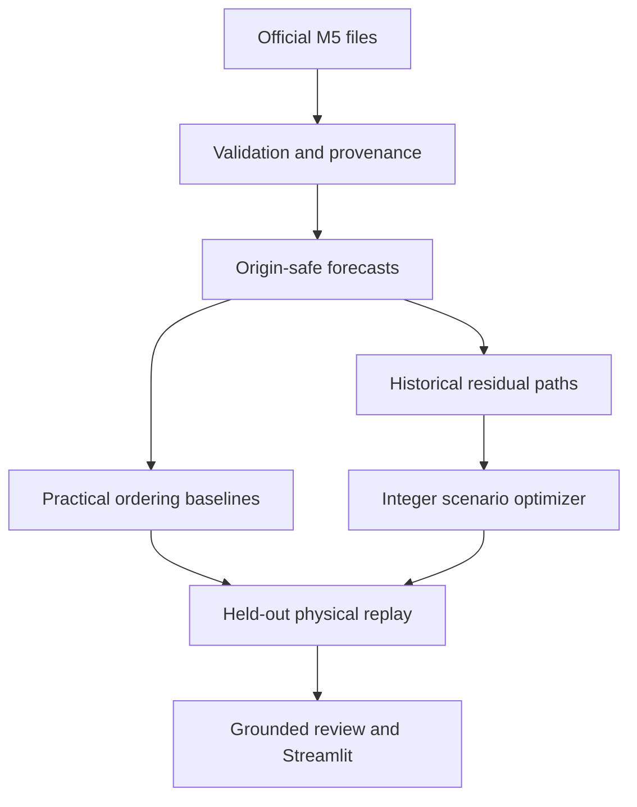

# RetailOS
### From Demand Forecasting to Better Inventory Decisions

[](https://github.com/younjuhan03/retail-decision-intelligence/actions/workflows/tests.yml)

**First real-data study completed. Research prototype; inventory recommendation remains REVIEW REQUIRED.**

RetailOS asks a business question: **can better sales forecasts and joint budget optimization improve inventory decisions over practical ordering rules?** It connects official M5 sales data, chronological forecasting, integer inventory optimization, policy replay and grounded decision review in a Streamlit application.

The first experiment found a useful failure: **gradient boosting reduced daily forecast MAE by 8.04%, but scenario optimization increased simulated inventory cost by 11.97% versus a trailing-average ordering policy.** Better average prediction did not produce a better allocation of the same purchasing budget.



## Verified first-run results

Scope: **42 product–store series**, two 28-day episodes covering **March 28–May 22, 2016**, and 2,352 held-out SKU-days. Initial inventory resets for each episode. The forecast model was selected on an earlier validation window; both final windows were held out for the original run.

| Forecast model | MAE, units/SKU-day | RMSE | WAPE |
|---|---:|---:|---:|
| Gradient boosting | **1.683** | **3.047** | **51.89%** |
| Trailing 28-day mean | 1.830 | 3.330 | 56.43% |
| Active-history mean | 1.855 | 3.240 | 57.20% |
| Seasonal naive | 2.107 | 4.003 | 64.95% |

| Inventory policy | Total simulated cost | Purchasing expenditure | Unmet-sales-proxy penalty | Proxy fill rate |
|---|---:|---:|---:|---:|
| Trailing-average orders | **$22,088.62** | $12,142.60 | $9,655.39 | 80.21% |
| Forecast order-up-to | $22,161.68 | $12,142.41 | $9,730.97 | **81.60%** |
| Scenario-optimized orders | $24,731.97 | $12,142.57 | $12,279.91 | 79.25% |

Cost increase: **11.97%** versus trailing-average orders and **11.60%** versus forecast order-up-to, using each matched baseline's total cost as denominator across the two paired episodes. Lower total modeled cost and higher unit fill rate are different objectives; no policy dominates every metric.

The empirical 10–90% daily scenario envelope covered **38.52%** of held-out observations. It is **not a calibrated 80% prediction interval**. Only three unique historical residual blocks supported eight sampled paths. Optimization was more costly than trailing-average orders in 12 of 13 alternative one-factor scenarios; the exception changed the shortage-penalty preference.

These are historical-sales-based counterfactual costs under assumed operating inputs, **not actual Walmart savings**. Independent physical replay reproduced all six policy-window costs.

- [Results, diagnosis and limits](docs/first_run_results.md)
- [Standalone English portfolio case study](docs/case_study.html) — download and open locally; GitHub displays HTML source.
- [Machine-readable aggregate evidence](docs/evidence/first_run.json)
- [Technical methodology](docs/methodology.md) and [verification report](docs/verification.md)

## Architecture and implementation



- **Data engineering:** wide-file filtering before melting, streamed weekly prices, checked joins, activation eligibility, SQL audit and SHA-256 provenance.
- **Forecasting:** historical mean, seasonal naive, rolling mean and global histogram gradient boosting. Direct multi-horizon features use only origin-available sales and prices; known-calendar features are an explicit assumption.
- **Optimization:** SciPy/HiGHS integer orders with shared purchasing budget, modeled initial stock, fixed lead time, daily holding and unmet-proxy penalties.
- **Decision evaluation:** identical constraints and held-out sales for all policies; independent accounting replay; six families of one-factor sensitivity checks.
- **Decision support:** deterministic explanations and status validation. No LLM is used to compute orders or invent figures. No API key is needed for the quantitative application.

## Install and run on Windows / VS Code

Open this project folder and use PowerShell:

```powershell
python -m venv .venv
.\.venv\Scripts\python.exe -m pip install --upgrade pip
.\.venv\Scripts\python.exe -m pip install -e ".[dev]"
.\.venv\Scripts\python.exe -m pytest -q
```

The original real-data run completed on Windows with Python **3.14.6**; CI targets Python 3.11. The original run's reported package versions are recorded in [first_run.json](docs/evidence/first_run.json). The instructions use the environment's Python directly, so no PowerShell activation-policy change is required.

Obtain the official data through your Kaggle account, review applicable terms, and put the files directly in `data/raw/`:

```text
data/raw/
  calendar.csv
  sell_prices.csv
  sales_train_evaluation.csv
  sales_train_validation.csv   # optional cross-release consistency check
```

```powershell
.\.venv\Scripts\python.exe -m retailos.cli audit
.\.venv\Scripts\python.exe -m retailos.cli run
.\.venv\Scripts\python.exe -m streamlit run app/streamlit_app.py
```

Without locally computed results, the app deliberately displays **DATA REQUIRED / HOLD**. The public aggregate evidence is a research snapshot; it is not a replacement for the local files needed to reproduce forecasts and interactive optimization.

## Dataset, provenance and publication scope

Sources: [official M5 data](https://www.kaggle.com/competitions/m5-forecasting-accuracy/data), [competition rules](https://www.kaggle.com/competitions/m5-forecasting-accuracy/rules), [M5 Competitors' Guide](https://storage.googleapis.com/kaggle-forum-message-attachments/772349/15032/M5-Competitors-Guide-Final-10-March-2020.pdf).

M5 records **unit sales**, which may understate unconstrained demand during stockouts. Selling prices are not purchase costs. Complete actual inventory, purchase costs and lost sales are unavailable. The compact experiment assumes purchase cost = 65% of last observed selling price, daily holding = 0.2% of assumed cost, unmet-proxy penalty = 3× assumed cost, lead time = 2 days, initial stock = 3 days of trailing sales, and budget = 75% of trailing purchasing need. There is no terminal salvage credit.

Raw CSVs, per-SKU processed data, local forecasts, detailed orders, virtual environments and credentials are excluded from Git. This repository adds deliberately exported **aggregate research summaries, original charts and app screenshots**, rather than source observations. The code's MIT license does not grant rights to M5 data. This work is not affiliated with or endorsed by Walmart or Kaggle. Current source-data redistribution permissions have not been verified; download data from the official source rather than republishing it.

## Evaluation protocol

- Origins d_1773, d_1801 and d_1829: residual calibration blocks.
- Origin d_1857: forecast model selection by cross-series MAE.
- Origins d_1885 and d_1913: original held-out evaluation episodes.
- Policies: trailing-average order-up-to, forecast order-up-to, and joint scenario optimization.
- If a baseline target exceeds budget, both baselines use the same proportional scaling and feasible integer rounding.
- Forecast errors include MAE, RMSE, WAPE when defined, signed bias and bottom-level RMSSE. This is not the full hierarchical competition WRMSSE.

The serialized policy name `historical_average` means the **trailing 28-day average ordering policy**. The forecast name `historical_mean` means the **all-active-history forecast**. They are distinct.

## Reproduce evidence and tests

```powershell
.\.venv\Scripts\python.exe -m pytest -q
.\.venv\Scripts\python.exe scripts/export_evidence.py --results results/local
```

The exporter independently replays saved orders before generating aggregate tables, figures and the English case study. Detailed source rows remain local. See [screenshot instructions](docs/screenshots.md) to capture actual app output after a successful run.

Tests cover schema/join checks, future-data perturbation, 28-day horizons, exhaustive optimizer comparison, integer/budget feasibility, hand-calculated accounting, solver timeout, decision status, activation eligibility, display aggregation, evidence export and Streamlit navigation. Synthetic fixtures verify software behavior; their metrics are never published as M5 findings.

## Limitations and next development

This first study does not establish a robust optimization advantage. Uncertainty support is sparse; the decision objective depends on assumed costs; episode resets and zero terminal salvage simplify operations; and only two test blocks were evaluated. No inferential confidence interval, calibrated-tail guarantee, causal business effect or production-readiness claim is supported.

Next: compare point-forecast and uncertainty-aware optimization on pre-test development windows, broaden residual histories, select policies using decision value, and freeze the method before a new holdout evaluation. The already inspected test windows can support exploratory reanalysis, not another untouched-test claim.

GitHub hosts this code and research documentation. It does **not** host a live Streamlit app. No external app deployment or real order placement has been performed. See [deployment notes](docs/deployment.md).

**Stack:** Python, pandas, NumPy, SQLite, scikit-learn, SciPy/HiGHS, PyArrow, Streamlit, Matplotlib and pytest.
