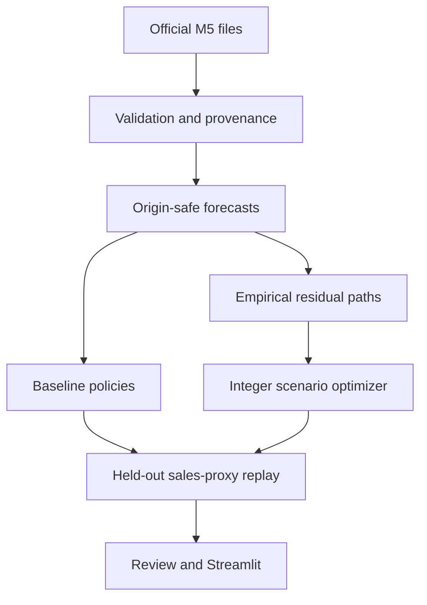

# RetailOS — From Demand Forecasting to Better Inventory Decisions

**Status: implemented and fixture-tested; primary M5 analysis BLOCKED pending official data.**

RetailOS asks whether forecasts plus joint budget optimization improve inventory decisions compared with practical order-up-to policies. It models counterfactual costs under explicit assumptions, not actual Walmart cost savings. This package is a working research implementation awaiting real-data execution, not a finished empirical portfolio result.

## What runs now

- Official-schema loader with streamed wide-file filtering, checked calendar/price joins, SQL data-quality audit and SHA-256 provenance.
- Three forecasting baselines and direct multi-horizon gradient boosting with chronological model selection.
- Integer scenario optimization with daily inventory accounting using SciPy/HiGHS.
- Shared-budget, shared-assumption baseline replay and six types of sensitivity analysis.
- Deterministic advisor/challenger/coordinator review with grounded decision statuses.
- Seven-section Streamlit app; honest missing-data screen until computed results exist.
- Pipeline-generated tables, chart and English HTML case study after authorized official data is provided.

**Verified software checks:** see [verification report](docs/verification.md). Test fixtures are artificial and are never primary analysis. No fabricated forecast metrics, cost reductions or trained M5 models are bundled.

## Architecture



## Data access and restrictions

Source: [official M5 dataset](https://www.kaggle.com/competitions/m5-forecasting-accuracy/data). Review [competition rules](https://www.kaggle.com/competitions/m5-forecasting-accuracy/rules) using your Kaggle account. This environment's unauthenticated API requests returned HTTP 401. No credentials were configured. The public rules page exposed no readable body through the available retrieval path; **usage and redistribution permissions remain unverified**. Do not infer permission from the code license or third-party mirrors.

Download and extract locally:

- `sales_train_evaluation.csv` (required; includes history through d_1941)
- `calendar.csv` (required)
- `sell_prices.csv` (required)
- `sales_train_validation.csv` (optional cross-release consistency check)

Use the Kaggle website, or the [official Kaggle CLI](https://github.com/Kaggle/kaggle-cli) after following its current authentication instructions and accepting any applicable access conditions:

```powershell
kaggle competitions download -c m5-forecasting-accuracy -p data/raw
Expand-Archive -Path data/raw/m5-forecasting-accuracy.zip -DestinationPath data/raw
```

Never put credentials into this repository or send API tokens in chat. Raw data, derived outputs, screenshots containing results and trained artifacts are excluded from Git by default until their release permissions are checked. Small size alone does not establish redistribution permission.

## Windows / VS Code quick start

Run from the extracted `retail-decision-intelligence` directory in PowerShell:

```powershell
py -3.11 -m venv .venv
.\.venv\Scripts\python.exe -m pip install -e ".[dev]"
.\.venv\Scripts\python.exe -m pytest -q
.\.venv\Scripts\python.exe -m retailos.cli audit
.\.venv\Scripts\python.exe -m retailos.cli run
.\.venv\Scripts\python.exe -m streamlit run app/streamlit_app.py
```

Using the virtual environment's Python directly avoids needing to change PowerShell execution policy. The app opens in a missing-data state even before data is added. The entire quantitative pipeline works without an LLM API key after data is supplied. Python 3.11 is the CI target. These Windows commands were documented but not executed on Windows in this Linux environment.

## Forecasting and decision protocol

Compact config: [configs/compact.json](configs/compact.json). Up to 42 product-store series across three stores and seven departments are selected using training information only. Origins d_1773/1801/1829 provide residual paths, d_1857 selects the model, and d_1885/1913 evaluate held-out decisions. No test optimization of model hyperparameters.

Forecasts: historical active-history mean, last-week seasonal naive, rolling 28-day mean, global histogram gradient boosting with Poisson loss. Reporting includes MAE, RMSE, WAPE where defined, bias, and bottom-level RMSSE (not full hierarchical M5 WRMSSE).

Inventory: one order each 28-day episode, fixed arrival delay, integer nonnegative quantities, shared purchasing budget, daily holding and unmet-sales-proxy penalty. Procurement is included in the cost objective. No terminal salvage credit. Initial inventory is reset equally for all policies at each episode. The historical-average and forecast order-up-to baselines use the same proportional feasibility adjustment. All policies replay identical observed held-out sales, never each other's forecasts.

See [methodology](docs/methodology.md) for equations, denominators, activation handling, uncertainty construction and economic interpretation; [dictionary](docs/data_dictionary.md) for field lineage.

## Verified empirical results

**Not yet available.** Official data could not be downloaded without authentication. Do not use artificial test metrics in an admissions application or resume. No superiority of machine learning or optimization is claimed.

After a successful real-data run, `results/local/` contains:

| Artifact | Purpose |
|---|---|
| `provenance.json` | Input hashes, selection cutoff, SQL audit |
| `forecasts.parquet`, `forecast_metrics.csv` | Actual forecasts and errors |
| `policy_evaluation.csv`, `allocations.csv` | Replay costs and exact integer orders |
| `sensitivity.csv` | One-factor scenario comparisons |
| `interval_coverage.csv` | Held-out uncertainty coverage |
| `summary.json`, `decisions.json` | Paired denominators, evidence flags, decision status |
| `cost_composition.png`, `case_study.html` | Computed figure and standalone English narrative |
| `environment.json`, `config.json` | Runtime versions and assumptions |

Review negative improvements, solver failures and sensitivity reversals. Two final test windows and three calibration blocks do not support strong population inference or calibrated tail-risk claims. Additional seasons, calibration origins and stores are a future extension; choose the protocol before inspecting new test results.

## Screenshots

Screenshot capture is not completed: the local app starts successfully, but the browser installation download failed in this environment. Streamlit AppTest verifies every screen using test fixtures. Result-filled publication screenshots must wait for authorized M5 execution and browser capture. No invented UI images are included.

## Testing and reproducibility

```powershell
.\.venv\Scripts\python.exe -m pytest -q
.\.venv\Scripts\python.exe -m retailos.cli run --config configs/compact.json --out results/local
```

Tests include exhaustive optimization comparison, hand-checked cost accounting, future-data perturbation, invalid inputs, budgets, lead times, origin horizons, residual chronology, official-schema joins, full fixture pipeline and Streamlit AppTest navigation. GitHub Actions executes fixture tests without Kaggle or AI credentials. A timestamp-free run and fixed random seed make allocations deterministic given the same versions and inputs; exact solver ties may differ across package versions. `environment.json` records the versions used in each run.

## Deployment

Local deployment is supported; no external deployment has been performed. See [deployment guide](docs/deployment.md). Do not upload licensed data to a public host until permitted use is confirmed. The app has no order submission or external messaging capability.

## Technologies and future improvements

Python, pandas, NumPy, SQLite, scikit-learn, SciPy/HiGHS, PyArrow, Streamlit, Matplotlib, pytest. Future work: longer blocked evaluation, richer uncertainty estimation, continuous replenishment with inventory carryover, stronger intermittent-demand models, server-side optional LLM explanations with numeric validation. They are not implemented or claimed in this release.

Code is MIT licensed; third-party data is excluded from that license.
