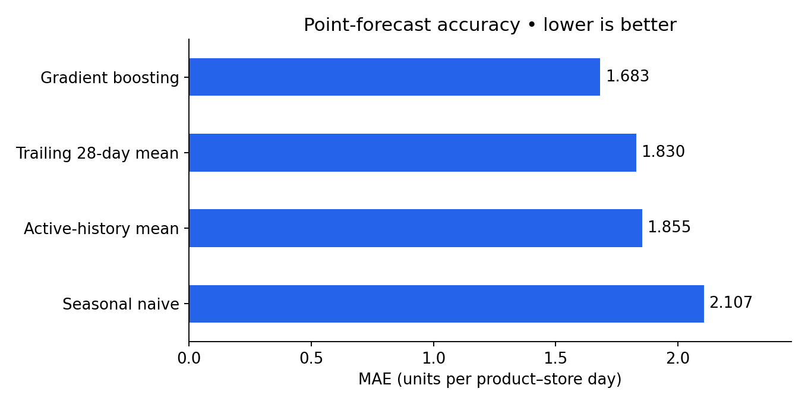
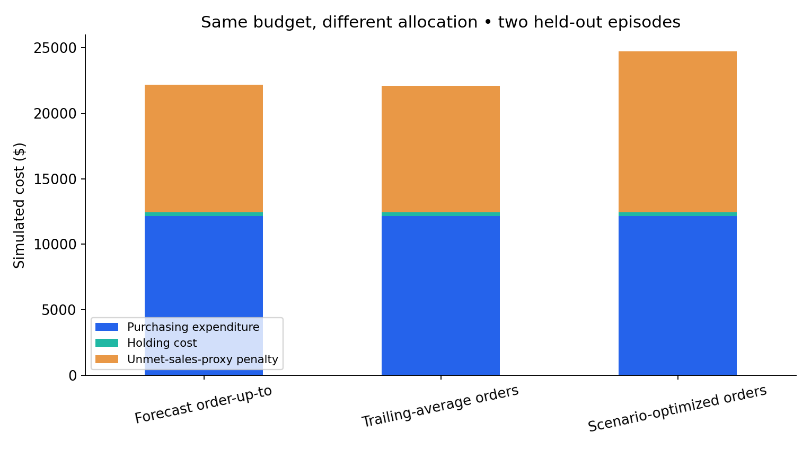

# First real-data results and diagnostic

Status: **computed; REVIEW REQUIRED**. This is an initial research result, not a production inventory recommendation.

## Scope and evidence

The user executed the official-data pipeline on Windows / Python 3.14.6 and supplied the complete result archive for inspection. The inspected run selected 42 product–store series across TX_1, CA_1 and WI_1; the selected panel has 81,522 daily rows. Seventeen candidates were excluded for insufficient early price-listing history. The final selected panel has 16,002 missing-price rows and zero positive-sales rows without a matching price. The optional validation release agrees on common selected observations.

The earlier pre-fix audit reported a different missing-price count because it selected different products. The final run's provenance, not that earlier audit, is the source for this document.

Evaluation: March 28–April 24 and April 25–May 22, 2016; 42 × 28 × 2 = 2,352 held-out SKU-days and 7,629 total observed-sales-proxy units. Initial inventory resets between episodes. Two time blocks do not support reliable population inference.

## Findings

| Measure | Trailing-average orders | Forecast order-up-to | Scenario optimization |
|---|---:|---:|---:|
| Total simulated cost | $22,088.62 | $22,161.68 | $24,731.97 |
| Purchasing expenditure | $12,142.60 | $12,142.41 | $12,142.57 |
| Holding cost | $290.63 | $288.30 | $309.50 |
| Unmet-proxy penalty | $9,655.39 | $9,730.97 | $12,279.91 |
| Unmet proxy units | 1,510 | 1,404 | 1,583 |
| Proxy fill rate | 80.21% | 81.60% | 79.25% |
| Ending inventory, summed over episodes | 694 | 671 | 1,165 |

Scenario optimization increased total modeled cost by $2,643.35 (**11.97%**) versus trailing-average orders and by **11.60%** versus forecast order-up-to. Each percentage uses the matched baseline's total cost over both episodes as denominator. No actual Walmart savings or loss was measured.

Gradient boosting's held-out daily MAE was **1.683**, compared with **1.830** for the trailing 28-day mean: an **8.04%** reduction. The forecast model was selected on the earlier d_1857 window. Improved average point accuracy did not translate into a better allocation under the assumed inventory objective.

## Accounting check and candidate explanation

A separate physical replay reproduced all six saved policy-window costs and checked nonnegative integer orders and cash feasibility. This supports the reported accounting; it does not prove every model assumption or implementation choice is correct.

Against trailing-average orders, purchasing expenditure changed by **-$0.039**, holding cost rose by **$18.86**, and unmet-proxy penalties rose by **$2,624.52**. More ending stock and more unmet sales occurred under essentially identical expenditure. The issue is allocation mismatch within this experiment.

Independent replay against the *original generated scenarios* favors the optimizer:

| Forecast origin | Policy | Scenario-expected cost | Held-out cost |
|---|---|---:|---:|
| d_1885 | Trailing-average orders | $10,491.82 | $12,282.61 |
| d_1885 | Forecast order-up-to | $10,533.71 | $12,387.65 |
| d_1885 | Scenario optimization | **$9,606.65** | $13,179.54 |
| d_1913 | Trailing-average orders | $11,077.14 | $9,806.01 |
| d_1913 | Forecast order-up-to | $10,768.99 | $9,774.03 |
| d_1913 | Scenario optimization | **$9,872.81** | $11,552.43 |

Thus the solver's preferred allocation is consistent with its modeled scenarios, while those scenarios did not adequately represent this held-out evaluation. Sparse or biased scenario support is a plausible contributor, **not an established sole cause**. Compare point-forecast optimization and alternative uncertainty methods before making a causal diagnosis.

Only **three unique earlier 28-day residual blocks** support eight sampled paths. The empirical 10–90% daily scenario envelope covers **38.52%** of held-out observations. That field was originally called `empirical_80pct_coverage`; it is retained for file compatibility but is **not a calibrated 80% prediction interval**.

## Sensitivity

Optimization was more costly than trailing-average orders in **12 of 13 alternative one-factor variants**, excluding the base case. The exception uses an unmet-proxy penalty equal to one unit purchase cost, a different economic preference. Do not select this favorable assumption after seeing test results to claim success. Scenario variants are correlated, not independent samples.

[Aggregate sensitivity table](evidence/sensitivity_totals.csv) · [Per-window policy totals](evidence/policy_windows.csv) · [Forecast metrics](evidence/forecast_metrics.csv) · [Evidence metadata](evidence/first_run.json)

## Current recommendation and next experiment

Retain simple ordering as the development benchmark and keep REVIEW REQUIRED for the optimizer. The historical-average policy has the lowest total modeled cost here; forecast order-up-to has the highest unit fill rate. No policy dominates every objective.

Preserve this run. Develop uncertainty methods using pre-test chronological windows, compare point-only and scenario optimization, and select the policy on development-period decision costs. Broaden stores/seasons and freeze the method before a genuinely new holdout evaluation. Already-inspected final windows may only support exploratory reanalysis.

All costs and stock variables are assumed; observed sales may be demand-censored; terminal salvage is zero; episodes reset initial inventory. These constraints limit any operational interpretation.
